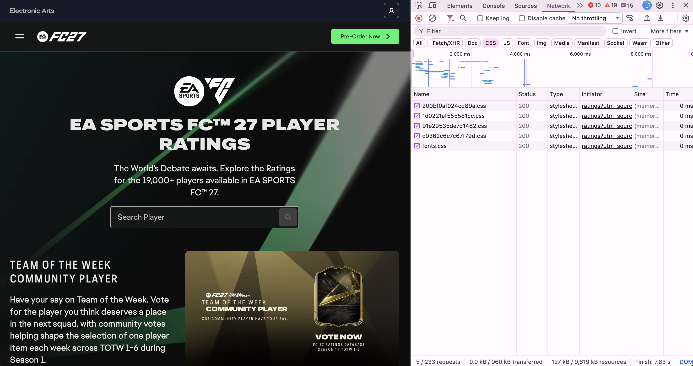

# Inspecting the Cultural Web: EA SPORTS FC 27 Player Ratings

## Website

For this assignment, I inspected the official EA FC 27 Player Ratings website:

https://www.ea.com/games/ea-sports-fc/ratings

I chose this website because my project interests involve sports analytics and how
soccer players are represented in video games. The EA SPORTS FC ratings website converts
player performance into numerical categories such as overall rating, pace, shooting,
passing, dribbling, defending, and physicality.

## Web Technologies

### HTML

The website uses HTML to organize the structure and content of the page.

Standard HTML elements include:
- `<!DOCTYPE html>`
- `<html>`
- `<head>`
- `<body>`
- `<script>`
- `
`

### CSS

The website uses CSS to control its visual appearance.

In the Network tab of Chrome Developer Tools, I filtered the page by CSS and found
multiple stylesheet files. There were several CSS files as included in the screenshot.

### JavaScript

The website also uses a large amount of JavaScript.

When I filtered the Network tab by JavaScript, I found many `.js` files. Some examples
included:

- `webpack-...js`
- `framework-...js`
- `main-...js`
- `_app-...js`
- `ratings-...js`

These files suggest that JavaScript is being used to provide the interactive parts of the
ratings website, including searching, filtering, navigation, and displaying player information.

## Frameworks and Other Technologies

Did not notice anything else used in the website.

## Who Built the Website?

The ratings website is an official Electronic Arts website that demonstrates their new game EA FC27

There is not an GitHub repo that is open to the public for this site, so I assume the ratings and the data given are from EA engineers and they are the main contributors to the website. However, it is hard to determine exactly how many people edited the site.

## Conclusion

Inspecting the site gave me a good example on how the basic structure of a webpage is like: HTML being the base structure, CSS providing visual elements, and JavaScript enabling user’s interaction with the site.

